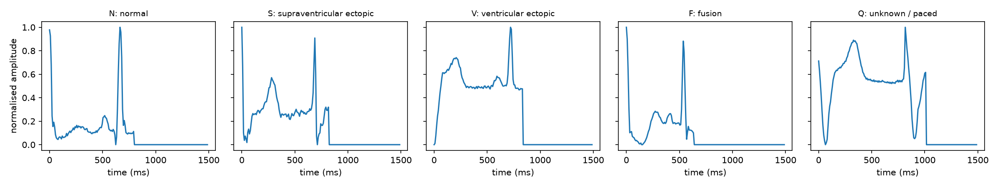
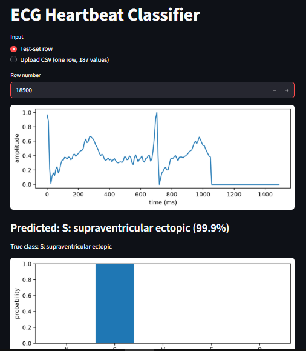

# ECG Heartbeat Classification: a neural network from scratch in PyTorch


A fully connected network (187 → 128 → 64 → 5) built from weight matrices, with He initialisation,
softmax cross-entropy, a hand-checked gradient and mini-batch gradient descent with momentum and
weight decay, all written by hand. It classifies single heartbeats from the MIT-BIH Arrhythmia
Database into five types: N, S, V, F and Q.

## Results (test set, 21,892 beats)

| | N | S | V | F | Q |
|---|---|---|---|---|---|
| Per-class accuracy | 99.54% | 66.73% | 91.44% | 64.81% | 97.64% |

- Test accuracy: **97.77%**
- Balanced accuracy: **84.03%** (a model that always answers "N" gets 82.76% accuracy)
- Chosen learning rate: α = 0.5, best epoch: 23 (lowest validation loss)

All tables are in `results/tables.md`, the answers to the analysis questions in
`results/analysis.md`, and the figures in `results/figures/`.

## Example beats



In these examples, N has a low baseline and one narrow, tall peak near 650 ms, while V is wider: the
signal stays between about 0.5 and 0.75 for most of the beat before peaking near 720 ms. S and F
resemble N but have a larger hump before the main peak, and F peaks earlier (about 540 ms) and ends
sooner. Q is the longest beat, with a dip to zero early on and a second dip near 950 ms.

## Parameter count

Layer 1: 187 × 128 + 128 = 24,064. Layer 2: 128 × 64 + 64 = 8,256. Layer 3: 64 × 5 + 5 = 325.
Total: 24,064 + 8,256 + 325 = 32,645.

## Links

- Medium blog: (https://medium.com/@junaidtanvir1122/can-a-small-neural-network-spot-dangerous-heartbeats-fc7713623917)
- LinkedIn post: (https://lnkd.in/p/d8evMUgB)

## Front end

The web app lets you pick a test-set row (or upload a CSV file with one row of 187 values),
shows the heartbeat, the predicted class and the probability of all five classes.



## Setup

1. Install the libraries: `pip install -r requirements.txt`
2. Download the dataset from https://www.kaggle.com/datasets/shayanfazeli/heartbeat
3. Create a folder named `data` in the repository root and put `mitbih_train.csv` and
   `mitbih_test.csv` in it (the CSV files are not stored in this repository).

## How to run

Run every command from the repository root.

```
python src/load_data.py      # Task 1.1: check that the files load
python src/plot_beats.py     # Task 1.5: example beat of each class (saved in results/figures/)
python src/prepare.py        # Task 1: data summary and train/validation split
python src/model.py          # Task 2: parameter count (32,645)
python src/grad_check.py     # Task 3: initial loss and gradient check
python src/train.py          # Task 4: trains with 3 learning rates, saves the best model
python src/test_model.py     # Task 5: test accuracy, confusion matrix, per-class accuracy
streamlit run app/app.py     # Task 7: web interface
```

The trained model is already included as `results/best_model.pt`, so `test_model.py` and the app
work without training again.

## Repository layout

```
data/         the two CSV files (not committed)
src/          load_data, plot_beats, prepare, model, grad_check, train, metrics, test_model
results/      figures/, tables.md, analysis.md, best_model.pt
app/          app.py (Streamlit front end)
requirements.txt
```